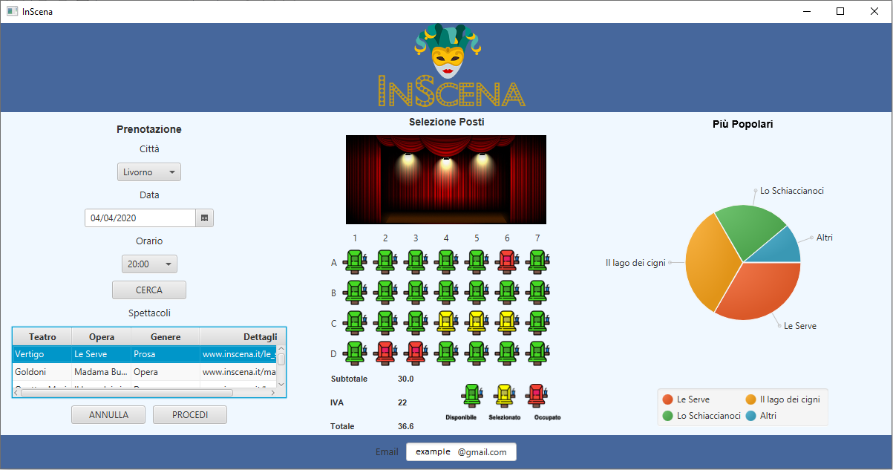

"In Scena" is a Java FX-based application designed for managing bookings for theater companies. This project was developed for the "Advanced Programming" course during my bachelor's degree and features a comprehensive system that allows users to book seats.

## Key Features 🔑
- **Interactive Seat Selection**: Users can visually select and reserve one or more seats from a graphical layout of the theater 🎟️.
- **Check Availability Search**: Check availability by date, city, and time to find available shows quickly 🔍.
- **Database**: Utilizes a MySQL database to store details such as city, show names, genre, theater names, and seat availability 🗃️.
- **Booking Summary**: Provides a breakdown of reserved seat numbers, prices, and total cost 💸.
- **Analytics and Logging**: Every click and action on the GUI is logged, allowing for detailed analytics and reporting to enhance future user experiences 📊.
- **Pie Chart Visualization**: Displays the popularity of shows using a pie chart, offering insights into the most popular performances at a glance 🥧.

## Setup and Installation ⚙️
To get the In Scena booking system running locally, follow the steps described at my GitHub repo [Here](https://github.com/enricollen/Theatre-Seat-Booking-System). 
(if you enjoyed this content please consider leaving a star ⭐)

## Screenshots 📸
Here are some screenshots illustrating the user interface of the theatre booking system:

