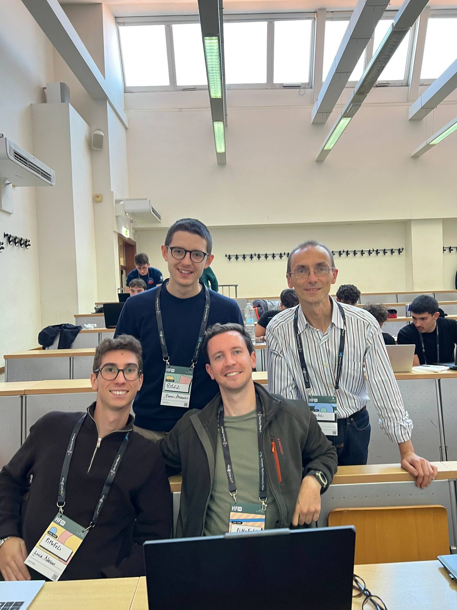
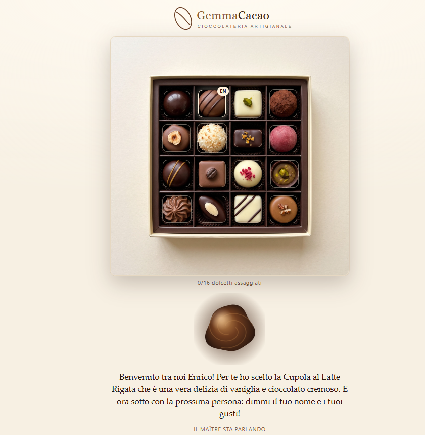
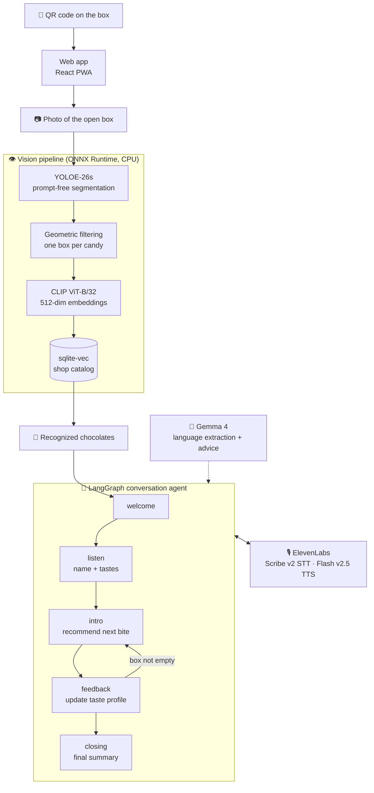
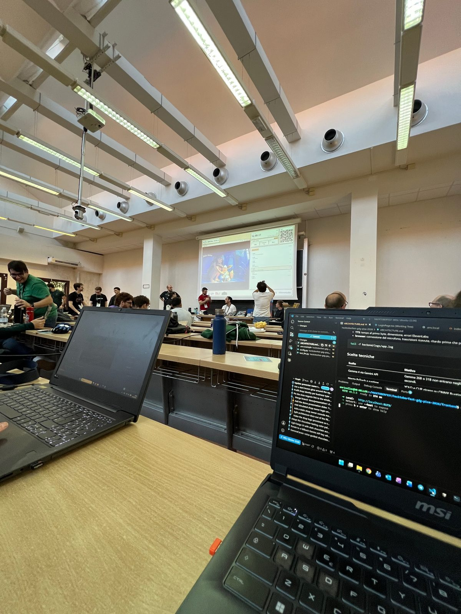
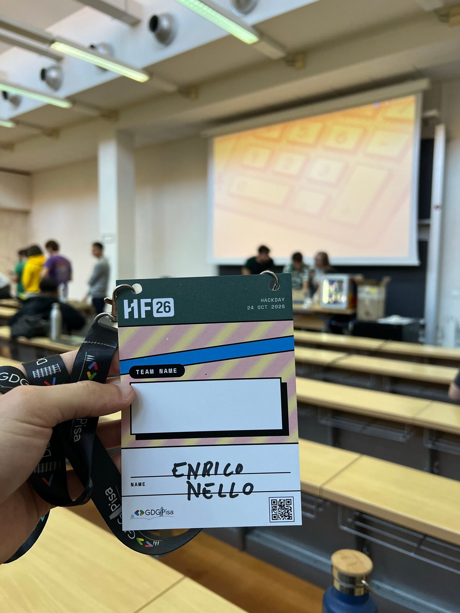
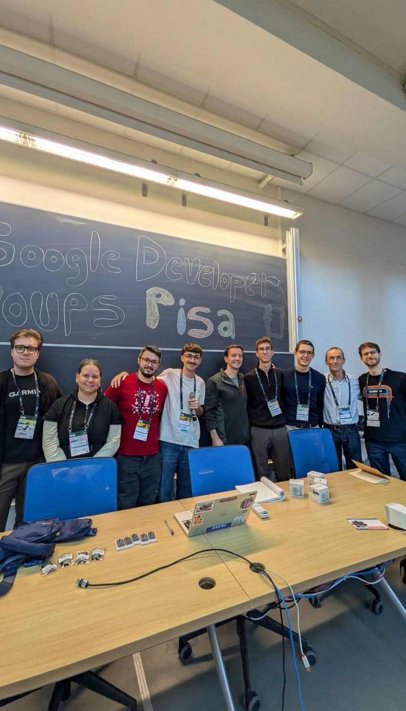
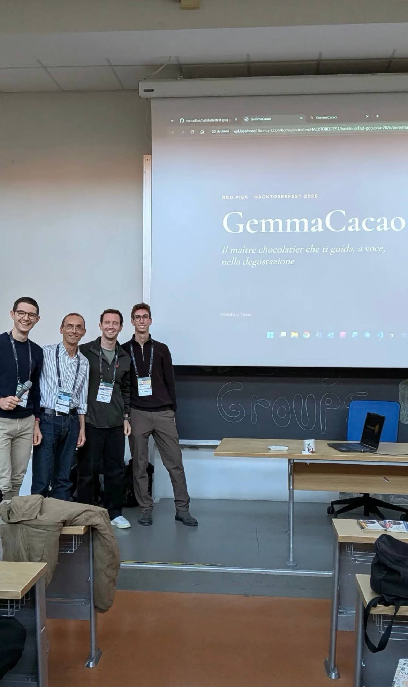

what a day!! on october 24th our team won the **Best Project Built with ElevenLabs** award at the [Hacktoberfest](https://hacktoberfest.com/) Hack Day organized by [GDG Pisa](https://gdg.community.dev/gdg-pisa/) at the **School of Engineering of the University of Pisa**.

the whole day was dedicated to building with **open source AI** and **open-weight models** — a format i really enjoyed: no closed black boxes, just models and tools you can actually inspect, run and hack on.

our team — **PiMoFeLi** — was composed of Pietro Argento, Luca Nasini, Lucio Grenzi and me. the name comes from the province codes of our four hometowns: **Pi**sa, **Mo**dena, **Fe**rmo and **Li**vorno.

<div align="center">
  
</div>

---

## 🍫 The Project: GemmaCacao

**GemmaCacao** is a virtual *maître chocolatier* — a voice agent that guides you through the tasting of a box of chocolates.

the flow is simple:

1. you scan the **QR code** on the box and land on the web app
2. you take a **photo of the open box** from above
3. the app **counts and recognizes** each chocolate, matching it against the shop's catalog
4. then the real conversation starts: the maître gets to know every person at the table, recommends the chocolate that best fits their taste, collects their comments after each bite, and **updates their taste profile** before suggesting the next one
5. at the end you get a **summary** with favorites, ratings and the taste profile discovered for each person

<div align="center">
  
</div>

*the box after recognition: 16 chocolates matched against the shop catalog, and the maître opening the tasting with a personalized suggestion.*

we picked a chocolate shop as our use case, but the same idea works for **any food retailer** that wants to offer an immersive tasting experience — wine shops, cheesemakers, coffee roasters, breweries and so on. and the shop owner gets something valuable in return: real, structured insight into what their customers actually like.

---

## 🧠 How It Works

the system is split into two halves: a **vision pipeline** that turns a photo into a list of known products, and a **conversational agent** that runs the tasting.



### 👁️ Recognizing the Chocolates

the recognition step is deliberately **not** a trained classifier — a chocolate shop changes its catalog constantly, so retraining a model for every new product would be a non-starter.

instead we went for a **detect-then-match** approach:

| stage | what it does |
|-------|--------------|
| **YOLOE-26s** (prompt-free segmentation) | finds every candy-like object in the photo |
| **geometric filtering** | class-agnostic NMS, container/decoration exclusion, size thresholds → exactly one box per candy |
| **Pillow** | crops each detection with a small margin |
| **CLIP ViT-B/32** (ONNX via fastembed) | encodes each crop into a 512-dim vector |
| **sqlite-vec** | nearest-neighbour search over the shop's catalog (80% image weight, 20% description weight) |
| **greedy assignment** | in an assorted box each product appears once, so matches are assigned without duplicates |

on our test box this gave **16/16 candies detected correctly in ~1.2 seconds on CPU**. adding a new product to the catalog means uploading one photo and a description — no retraining.

both models run on **ONNX Runtime** on CPU: ~350 MB of footprint instead of the ~6 GB a PyTorch stack would have required. that mattered a lot on hackathon laptops.

### 💬 The Conversation

the agent is a **LangGraph state machine** with five phases:

| phase | purpose |
|-------|---------|
| **welcome** | triggered once the photo is recognized and the group size is set |
| **listen** | captures each participant's name and taste preferences |
| **intro** | generates the personalized recommendation for the next bite |
| **feedback** | parses the comment after the tasting and updates the taste profile |
| **closing** | wraps up with the final summary when the box is empty (or on request) |

the design principle we stuck to: **the code decides the flow, the LLM handles language**. Gemma takes care of extracting names, tastes and allergies from free-form speech and of generating the advice; routing, validation and termination are deterministic. this is what kept the demo stable on stage.

conversation state is persisted in a **SQLite checkpoint database**, so the tasting survives a page reload — which, in a room full of people passing a phone around, is less of a detail than it sounds.

### 🛡️ Robustness

a live demo in front of a jury is the worst possible moment for a rate limit, so we built in a few defences:

- **redundant LLM calls**: parallel Gemma requests with a 20s timeout and a fallback API key on rate limits
- **rule-based fallback** (`agent/rules.py`): extracts name, tastes, allergies and ratings without any LLM call
- **bounded interaction**: the name is asked at most 3 times (then it falls back to "Guest N"), feedback once — the flow never gets stuck on a participant
- **recommendation validation**: code-level checks replace any candidate that is unavailable or conflicts with a declared allergy

---

## 🎙️ Giving the Maître a Voice

this is the part that won us the ElevenLabs prize, and honestly the part that changed the feel of the whole product.

- **[Scribe v2 Realtime](https://elevenlabs.io/)** for speech-to-text, connected **directly from the browser over WebSocket** using an ephemeral token issued by the backend — so audio doesn't make a detour through our server. both **VAD** and **push-to-talk** modes are supported, the latter being a lifesaver in a noisy hackathon room (there's a text fallback too).
- **Flash v2.5** for streaming text-to-speech with an italian voice.

combined with Gemma 4 reaching first token in about a second, the result is a tasting that genuinely feels like **chatting with a real person** rather than querying an app.

---

## 🛠️ Tech Stack

- **LLM:** Google [Gemma 4](https://ai.google.dev/gemma) (`gemma-4-26b-a4b-it`, 26B MoE with ~4B active params) — `thinking_level="minimal"` + JSON schema validation
- **agent framework:** [LangGraph](https://langchain-ai.github.io/langgraph/)
- **vision:** YOLOE-26s + OpenAI CLIP ViT-B/32, both on **ONNX Runtime** (CPU)
- **voice:** [ElevenLabs](https://elevenlabs.io/) Scribe v2 Realtime (STT) + Flash v2.5 (TTS)
- **backend:** Python 3.13, FastAPI + Uvicorn
- **frontend:** React 19 + TypeScript, Vite, PWA (manifest + service worker)
- **database:** SQLite + [sqlite-vec](https://github.com/asg017/sqlite-vec) for vector search
- **tooling:** uv, Makefile

---

## 📁 Project Structure

```plaintext
hacktoberfest-gdg-pisa-2026/
├── backend/              # FastAPI server, LangGraph agent, vision pipeline
├── frontend/             # React PWA (photo → detection → tasting → summary)
├── img/                  # sample images and catalog descriptions
├── presentation/         # HTML5 slides used for the pitch
├── ARCHITECTURE.md       # technical deep dive
└── Makefile              # setup & dev automation
```

getting it running locally is two commands:

```bash
cp backend/.env.example backend/.env   # ElevenLabs + Google AI Studio keys
make setup
make dev                               # backend :8000, frontend :5173
```

then open `http://localhost:5173/s/demo`.

---

## 🎬 Conclusion

building a product that is *visual*, *conversational* and *voice-first* in a single day meant making a lot of hard calls fast — and most of the good ones were about **letting code do what code does well** and keeping the model where language genuinely helps.

a special thanks to the whole **GDG Pisa** team for the organization and for bringing such a great event to Pisa 🙏🏻 and to my teammates Pietro, Luca and Lucio for a genuinely fun day of building.

### 🔗 GitHub Repository
visit the project repository [here](https://github.com/enricollen/hacktoberfest-gdg-pisa-2026) for accessing the full codebase (if you enjoyed this content, please consider leaving a star ⭐).

### 📸 Photos

<div style="display: flex; flex-wrap: wrap; gap: 10px;">
  
  
  
  
  
  
</div>
